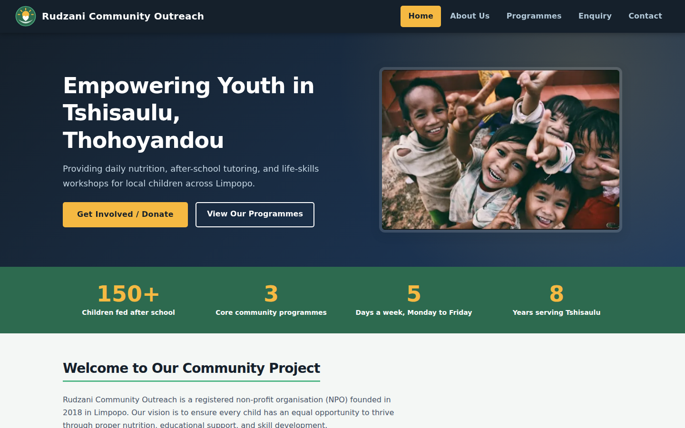
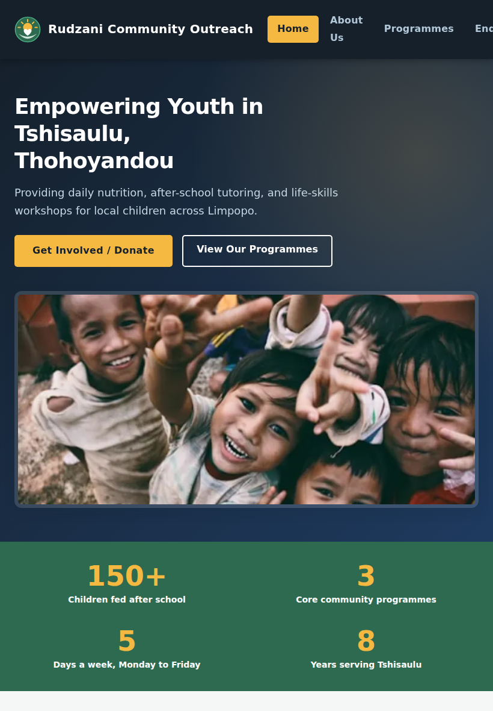
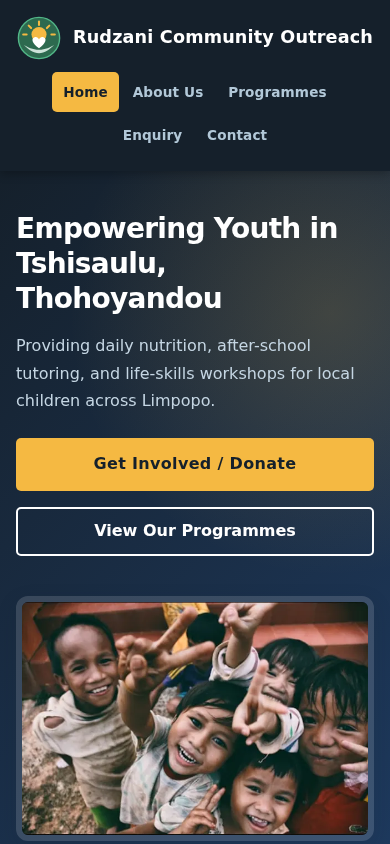
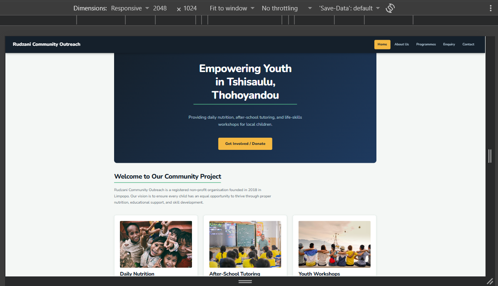
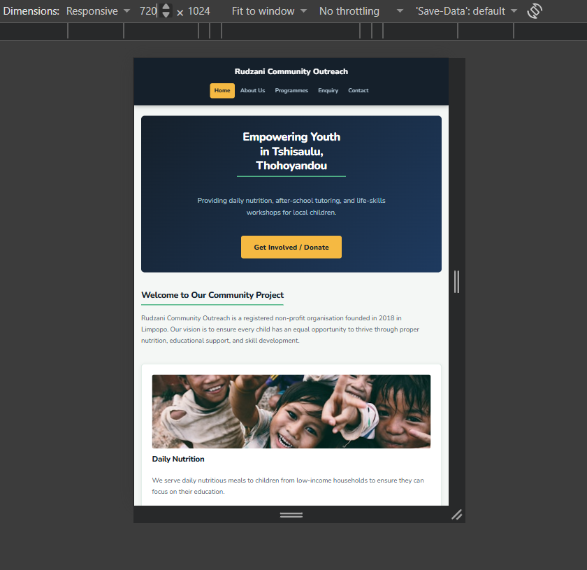
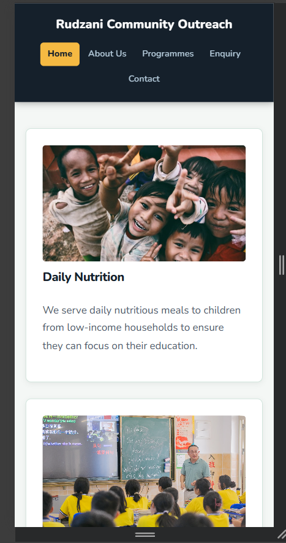

[](https://classroom.github.com/a/PhWn_eB9)
[](https://classroom.github.com/online_ide?assignment_repo_id=24295459&assignment_repo_type=AssignmentRepo)

# Rudzani Community Outreach — Website Development
## ANZA MAHWASANE
## IIE ROSEBANK INTERNATIONAL
## PORTFOLIO OF EVIDENCE

## 1. Table of Contents
1. [Table of Contents](#1-table-of-contents)
2. [Project Overview](#2-project-overview)
3. [Proposal Summary](#3-proposal-summary)
4. [Technologies Used](#4-technologies-used)
5. [Built With](#5-built-with)
6. [How to View the Website](#6-how-to-view-the-website)
7. [Repository Structure](#7-repository-structure)
8. [Part 3 — Functionality and SEO](#8-part-3--functionality-and-seo)
   - [8a. Deployment and Submitting This Work](#8a-deployment-and-submitting-this-work)
9. [Changelog](#9-changelog)
10. [Evidence Screenshots](#10-evidence-screenshots)
11. [References](#11-references)

## 2. Project Overview

An interactive, responsive website for **Rudzani Community Outreach**, a registered Non-Profit Organisation (NPO) founded in 2018 in Tshisaulu, Thohoyandou, Limpopo. The website serves as a digital presence to inform parents, volunteers, corporate sponsors, and community members about youth empowerment programmes and daily nutritional support.

This project was developed as a Portfolio of Evidence (PoE) submission for the Diploma in Information Technology in Software Development at The IIE's Rosebank College.

## 3. Proposal Summary

Approved Proposal: Proposal 1 — Rudzani Community Outreach Website

**Goals**
- Create an accessible and informative website representing a real community NPO in Limpopo.
- Provide information about the organisation's daily nutritional programme, after-school tutoring, and youth empowerment workshops.
- Offer a volunteer and donor enquiry form to facilitate community engagement.

**Target Audience**
- Parents and guardians of children in the Tshisaulu area.
- Student volunteers from local universities and colleges.
- Corporate donors and sponsors.
- The general public interested in community development in Limpopo.

## 4. Technologies Used

| Technology | Purpose |
|---|---|
| HTML5 | Semantic page structure for all five pages, plus a custom 404 page |
| CSS3 | Styling, layout (Flexbox + CSS Grid), animations and responsive design |
| Google Fonts | Nunito typeface (weights 400, 600, 700, 800) loaded with `<link>` tags |
| CSS Custom Properties | Design token system for colours, spacing and typography |
| CSS Media Queries | Responsive breakpoints for desktop, tablet and mobile |
| JavaScript (ES6) | Form validation, dynamic content, search/filter/sort, modal, lightbox, map and AJAX |
| jQuery 3.7.1 | Tabs (About page) and the FAQ accordion (Enquiry page), self-hosted in `js/vendor/` |
| Leaflet 1.9.4 + OpenStreetMap | Interactive map and directions on the Contact page, self-hosted in `js/vendor/` |
| JSON-LD (schema.org) | Structured data for search engines on the Home and Contact pages |
| `robots.txt` + `sitemap.xml` | Search engine crawling and indexing instructions |
| Pexels / Unsplash-style stock media | Royalty-free photography and video for the programme pages |
| Git / GitHub | Version control and remote repository hosting |

## 5. Built With
* **HTML5:** Semantic structuring and multi-page routing, including a custom `404.html`.
* **CSS3:** Custom styling, CSS Variables, Flexbox, and CSS Grid layout models.
* **Google Fonts:** Utilising 'Nunito' for modern typography.
* **Responsive Design:** Mobile-first media queries for cross-device compatibility.
* **Vanilla JavaScript + jQuery:** Form validation, dynamic DOM content, and interactive components.
* **Leaflet.js:** An open-source interactive map (no API key required).

## 6. How to View the Website

### Option A: Local Browser
1. Clone or download the repository to your local machine.
2. Navigate to the project folder.
3. Double-click `index.html` to open it in any modern browser (Chrome, Edge, Firefox).

### Option B: VS Code Live Server (Recommended)
1. Open the project folder in **Visual Studio Code**.
2. Install the **Live Server** extension.
3. Right-click on `index.html` and select **"Open with Live Server"**.

> A local server (Live Server, or `python -m http.server`) is recommended for Part 3, because the interactive map and the AJAX form submission work best when the site is served over `http://` rather than opened directly as a `file://` path.

### Option C: Live Deployment
The site is deployed for free on Netlify (drag-and-drop of this folder, or connected to this GitHub repository). See the live link shared on the Learning Management System submission.

## 7. Repository Structure
```
├── css/
│   └── style.css
├── images/
│   ├── logo.svg
│   ├── favicon.svg
│   ├── rudzani-community-outreach-social-share.jpg
│   ├── part2-desktop-screenshot.png
│   ├── part2-tablet-screenshot.png
│   ├── part2-mobile-screenshot.png
│   ├── part3-desktop-screenshot.png
│   ├── part3-tablet-screenshot.png
│   ├── part3-mobile-screenshot.png
│   ├── children-smiling-daily-nutrition(.webp / -thumb.webp)
│   ├── after-school-tutoring-classroom(.webp / -thumb.webp)
│   ├── youth-empowerment-friends-workshop(.webp / -thumb.webp)
│   ├── volunteers-sorting-food-donations(.webp / -thumb.webp)
│   ├── classroom-learners-after-school-programme(.webp / -thumb.webp)
│   ├── students-studying-together-learning-support(.webp / -thumb.webp)
│   └── youth-empowerment-hands-globe-illustration(.webp / -thumb.webp)
├── js/
│   ├── data.js
│   ├── script.js
│   └── vendor/
│       ├── jquery-3.7.1.min.js
│       └── leaflet/ (leaflet.js, leaflet.css, images/)
├── Videos/
│   ├── daily-nutrition-programme.mp4
│   ├── after-school-programme.mp4
│   ├── learning-support-tutoring.mp4
│   └── youth-empowerment-workshop.mp4
├── about.html
├── contact.html
├── enquiry.html
├── index.html
├── programmes.html
├── 404.html
├── robots.txt
├── sitemap.xml
└── README.md
```

## 8. Part 3 — Functionality and SEO

**JavaScript enhancements**
- **Interactive elements:** a "Quick view" modal on the Home page, tabbed content on the About page (jQuery), an accordion FAQ on the Enquiry page (jQuery), and a photo gallery with a full keyboard- and swipe-friendly lightbox on the About page.
- **Interactive map:** the Contact page embeds a Leaflet + OpenStreetMap map centred on Thohoyandou, with a marker, a "Get Directions" link to Google Maps, and a "How far am I from you?" button that uses the browser's geolocation API.
- **Animations and transitions:** scroll-reveal fade-ups (`IntersectionObserver`), animated impact counters, a "back to top" button, and hover/focus transitions across buttons, cards and form fields. All animation respects `prefers-reduced-motion`.
- **Dynamic content:** the Programmes page builds its activity cards directly from `js/data.js` using DOM methods (no `innerHTML` of user data, to avoid XSS), and includes a live search box, a programme filter, a sort order, and a "Load more" button.
- **Form functionality and validation:** both `enquiry.html` and `contact.html` use HTML5 form elements (`input`, `select`, `textarea`, `fieldset`) together with HTML5 validation attributes (`required`, `pattern`, `minlength`/`maxlength`, `min`/`max`) *and* a JavaScript validation layer that shows inline, accessible error messages as the visitor types.
  - `enquiry.html` shows extra fields depending on whether the visitor selects **Volunteer Sign-Up** or **Donor / Sponsor Enquiry**, then — once validated — calculates and displays either the number of open volunteer spots for the chosen activity (from `js/data.js`) or an estimated sponsorship cost, and submits the data in the background with the Fetch API (AJAX) so the page does not reload.
  - `contact.html` compiles the validated input into a ready-to-send email (subject + body), which the visitor can open directly in their own email app via a `mailto:` link or copy to the clipboard.
  - **Both forms** also carry `data-netlify="true"` and a hidden `form-name` field, so that if this site is deployed on Netlify, Netlify's free Forms service automatically captures every submission and can email it to the organisation with no backend code — see the note under "Deployment" below. On any other host (GitHub Pages, etc.) this attribute is simply ignored and both forms keep working exactly as described above through `script.js`.

**Search Engine Optimisation**
- **On-page SEO:** unique, keyword-focused `<title>` and meta description per page; a `<meta name="keywords">` tag per page (note: modern search engines like Google no longer use this tag to rank pages, but it is included because it is still good practice to document a page's target keywords, and some smaller/regional search engines still read it); a full heading hierarchy (`h1` → `h3`); descriptive `alt` text and descriptive file names for every image; clean, lower-case URLs; and internal links between related pages (e.g. Home → About/Programmes/Enquiry, About → Contact/Enquiry).
- **Structured data:** JSON-LD `NGO` schema on the Home and Contact pages (name, address, opening hours, coordinates) to support local search and rich results.
- **Social sharing:** Open Graph and Twitter Card meta tags with a custom share image (`images/rudzani-community-outreach-social-share.jpg`).
- **Off-page SEO:** the footer links to the organisation's Instagram page, and `robots.txt` + `sitemap.xml` are provided so search engines can crawl and index the site efficiently.
- **Mobile-friendliness and page speed:** all photography is served as compressed WebP, all four programme videos are re-encoded H.264 MP4 with `preload="none"` so they only download when played, Google Fonts are loaded with `preconnect`, and jQuery/Leaflet are self-hosted rather than fetched from a third-party CDN.

## 8a. Deployment and Submitting This Work

Two steps are still outstanding on your side, because I cannot sign in to your GitHub or Netlify account for you:

**1. Push this folder to GitHub with multiple, descriptive commits** (rather than one large commit) — for example:
```
git add css/style.css js/data.js js/script.js js/vendor
git commit -m "Add Part 3 JavaScript: modal, tabs, lightbox, search/filter/sort and Leaflet map"

git add enquiry.html contact.html
git commit -m "Add Part 3 form validation, conditional fields, cost calculator and email preview"

git add index.html about.html programmes.html 404.html robots.txt sitemap.xml
git commit -m "Add SEO: meta tags, JSON-LD, sitemap, robots.txt and a custom 404 page"

git add images/logo.svg images/favicon.svg images/*.webp Videos
git commit -m "Fix Part 2 feedback: add logo graphic, compress images/videos to WebP and MP4"

git add README.md
git commit -m "Rewrite README: versioned changelog tied to commits, fixed table of contents and condensed references"

git push
```

**2. Deploy the site** on a free platform (Netlify, GitHub Pages, etc.) and add the live link to your submission. To deploy on Netlify specifically:
1. Sign in to [netlify.com](https://www.netlify.com) and choose "Add new site" → "Import an existing project" → connect this GitHub repository (or drag-and-drop this folder for a quick manual deploy).
2. No build command is needed — this is a static site, so leave the build command blank and set the publish directory to the project root.
3. Once deployed, open **Site configuration → Forms** and turn on **email notifications** for the `enquiry` and `contact` forms so submissions land in your inbox automatically.
4. Update the `BASE` URL used throughout the `<head>` of every page (currently `https://rudzani-community-outreach.netlify.app`) to match the actual address Netlify gives your site, so the canonical links, sitemap, Open Graph tags and JSON-LD all point to the right place.

## 9. Changelog

This changelog groups the project's GitHub commits into released versions. Commit hashes refer to commits on `main` in this repository.

### [v2.0.0] — Part 3: Functionality, SEO and form processing
*(this submission — see the commits made when this folder is pushed to GitHub)*
- **Added:** `js/data.js` holding the programme, sponsorship and gallery data used to build pages dynamically.
- **Added:** `js/script.js` — scroll-reveal animations, animated counters, the Quick View modal, the About page tabs and lightbox gallery, the Programmes search/filter/sort/load-more, full form validation for both forms, the enquiry cost/spots calculator with AJAX submission, the contact-form email composer, and the Leaflet map with geolocation distance.
- **Added:** jQuery 3.7.1 and Leaflet 1.9.4 (self-hosted under `js/vendor/`) for the tabs/accordion and the interactive map.
- **Added:** `robots.txt`, `sitemap.xml`, JSON-LD structured data, Open Graph/Twitter Card tags, per-page meta keywords, and a social share image for SEO.
- **Added:** Netlify Forms capture (`data-netlify="true"` + hidden `form-name` field) on both `enquiry.html` and `contact.html`, so submissions can be emailed to the organisation automatically once deployed, on top of the client-side validation/response already described above.
- **Added:** `images/logo.svg` and `images/favicon.svg` so the organisation has a visible logo in the header, not only heading text.
- **Added:** a custom `404.html` page.
- **Added:** compressed WebP images and re-encoded MP4 video for every programme photo/video, cutting the media folder from roughly 55 MB to under 3 MB.
- **Fixed (Part 2 feedback):** the logo is now a graphic in the top-left of the header on every page, not text alone.
- **Fixed (Part 2 feedback):** the Contact page now has an embedded interactive map (Leaflet/OpenStreetMap) with a marker and directions link, not text and a form only.
- **Fixed (Part 2 feedback):** this changelog is now written as dated, versioned entries tied to GitHub commits, instead of one block of repeated "Added"/"Fixed" headings.
- **Fixed (Part 2 feedback):** the table of contents above now matches the document's actual section numbers (the old list repeated "7" and skipped "9").
- **Fixed (Part 2 feedback):** the references section (below) is now a short reference list instead of a long block of raw links.

### [v1.1.2] — 2026-10-27
- `a3177eb` Rename project from ST10524165_PROG6112_Test to ST10524165_WEDE5020_POE.

### [v1.1.1] — 2026-09-28
- `62ff3db` Add files via upload.

### [v1.1.0] — Part 2: Layout & Responsive Upgrade — 2026-09-18
- `4d2cb65` Complete Part 2 styling, responsive layout, and README changelog — added `css/style.css` linked from all five pages, a CSS custom-property design token system (`--colour-ink`, `--colour-forest`, `--colour-sage`, `--colour-sunlight`, `--colour-paper`, `--colour-cloud`), the "Our Goal" card on `about.html`, a universal `box-sizing: border-box` reset, `scroll-behavior: smooth`, a sticky-footer flex layout on `body`, `:hover`/`:focus`/`:active` states for navigation links, buttons and form inputs, the header/navigation Flexbox layout, the `.card-grid` CSS Grid layout, the Nunito Google Font, and responsive `@media` rules for tablet and mobile.
- `8e02fbe` Change mobile view layout.
- `304a07b` Fix HTML structure and standardize file paths — standardised every page to `href="css/style.css"` and closed a missing `</div>` before `</main>`.
- `2c5e983` Added a new file structure and 3 programme images.
- `a370a0d`, `1abb92b`, `7373c5b`, `d476353`, `0a107db`, `d70ae07`, `1a007df`, `ff9d3f8` Revised and corrected the README's structure, table of contents, Project Overview and Proposal Summary wording, and evidence screenshot image paths.
- `e7eb421` Merged the `main` branch after the above README revisions.

### [v1.0.0] — Part 1: Initial Structure — 2026-08-08 to 2026-08-14
- `a367237` Added the GitHub Classroom deadline badge and online IDE link.
- `4dd1d18` Created `index.html`.
- `fac622c` Added `about.html`, `contact.html`, `enquiry.html`, `index.html` and `programmes.html`.
- `8ee71aa` Renamed pages to their final file names (`index.html`, `programmes.html`).
- `82f6b94` Added the first 3 programme images.

## 10. Evidence Screenshots

### Part 3 — Desktop View (1440px)

### Part 3 — Tablet View (820px)

### Part 3 — Mobile View (390px)


### Part 2 — Desktop View (1024px+)

### Part 2 — Tablet View (768px – 1023px)

### Part 2 — Mobile View (767px and below)


## 11. References

GitHub Docs (2024) *About commits*; Google Fonts (2024) *Nunito*; MDN Web Docs (2024) *Responsive images*, *Using media queries*, *IntersectionObserver API* and *Fetch API*; Leaflet.js (2024) *Leaflet documentation* (leafletjs.com); OpenStreetMap contributors (2024) *OpenStreetMap* (openstreetmap.org); jQuery Foundation (2024) *jQuery API documentation* (api.jquery.com); schema.org (2024) *NGO schema*; Google Search Central (2024) *SEO Starter Guide*; Pexels (2024) *Free stock videos*; W3Schools (2024) *CSS Flexbox*, *CSS Grid Layout* and *HTML Video tag*.
